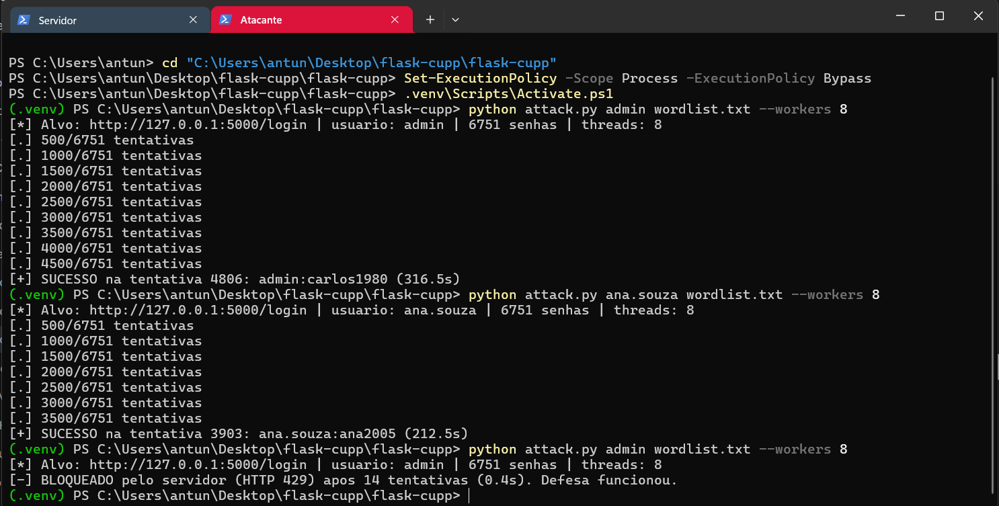
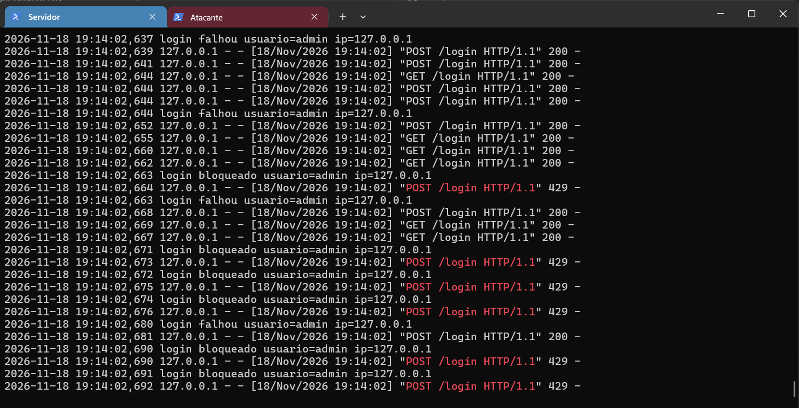

<div align="center">

```text
    ______           __                              
   / __/ /___ ______/ /__      _______  ______  ____ 
  / /_/ / __ `/ ___/ //_/_____/ ___/ / / / __ \/ __ \
 / __/ / /_/ (__  ) ,< /_____/ /__/ /_/ / /_/ / /_/ /
/_/ /_/\__,_/____/_/|_|      \___/\__,_/ .___/ .___/ 
                                      /_/   /_/      
```

**Ataque de dicionário com CUPP contra um portal Flask, e a defesa que o barra.**


</div>

---

> **Uso exclusivo em laboratório.** A aplicação tem senhas fracas de propósito e o script de ataque só aceita alvos em `localhost`. Todos os dados são fictícios. Não use essas técnicas contra sistemas sem autorização por escrito.

## Visão geral

Portal acadêmico em Flask com dois níveis de acesso (administrador e aluno), criado para estudar a fase de pós-exploração e o risco de senhas previsíveis. O projeto reproduz o ciclo completo:

```text
  dados do alvo        wordlist             ataque              resultado
 (nome, ano, pet)  ->   CUPP        ->   attack.py       ->   credencial ou 429
                                         (threads, CSRF)
```

1. `app.py`: portal Flask + SQLite. O administrador edita notas; o aluno só visualiza os próprios dados e notas (tentativa de edição retorna 403).
2. `scripts/gen_wordlist.sh`: gera `wordlist.txt` com o [CUPP](https://github.com/Mebus/cupp) a partir de dois perfis fictícios.
3. `attack.py`: tenta cada senha contra `/login`, com várias threads, e entende token CSRF e bloqueio HTTP 429.
4. Modo endurecido (`HARDENED=1`): mostra como bloqueio por tentativas e CSRF barram o mesmo ataque.

## Demonstração

Ataque contra o portal nos dois modos. As duas primeiras execuções acham as senhas no modo vulnerável; a terceira, com o portal endurecido, é bloqueada em menos de 1 segundo.



Log do servidor no modo endurecido: as falhas de login são registradas e, depois do limite, o portal passa a responder 429.



## Resultados

Credenciais de teste: `admin:carlos1980` e `ana.souza:ana2005`, ambas presentes na wordlist.

| Cenário | Resultado |
|---|---|
| Vulnerável, admin, 8 threads | senha na tentativa 4806 (212 s a 316 s, conforme a máquina) |
| Vulnerável, aluna, 8 threads | senha na tentativa 3903 (212 s) |
| Endurecido, admin, 8 threads | bloqueado com HTTP 429 após 13 a 14 tentativas, em menos de 1 s |

O tempo por tentativa é dominado pelo hash scrypt das senhas, que já encarece o ataque; por isso o ganho com threads é limitado.

## Como rodar

Linux e macOS:

```bash
python3 -m venv .venv && . .venv/bin/activate
pip install -r requirements.txt

python3 init_db.py        # cria o banco
python3 app.py            # terminal 1: portal em http://127.0.0.1:5000

python3 attack.py admin wordlist.txt --workers 8       # terminal 2
python3 attack.py ana.souza wordlist.txt --workers 8
```

Windows (PowerShell):

```powershell
python -m venv .venv
Set-ExecutionPolicy -Scope Process -ExecutionPolicy Bypass
.venv\Scripts\Activate.ps1
pip install -r requirements.txt

python init_db.py
python app.py             # terminal 1

python attack.py admin wordlist.txt --workers 8        # terminal 2
```

Gerar a wordlist de novo (opcional, Linux): `./scripts/gen_wordlist.sh`.

## Modos do portal

| | Vulnerável (padrão) | Endurecido (`HARDENED=1`) |
|---|---|---|
| Limite de tentativas | não | 5 falhas por usuário em 5 min, depois HTTP 429 |
| Token CSRF | não | sim, em todos os POST |
| Cookie de sessão | padrão | HttpOnly e SameSite=Lax |
| Segredo da sessão | fixo | aleatório a cada início |
| Log de falhas de login | sim | sim |

```bash
HARDENED=1 python3 app.py                # Linux e macOS
$env:HARDENED = "1"; python app.py       # PowerShell
```

Variáveis opcionais: `MAX_FALHAS`, `JANELA_BLOQUEIO` (segundos) e `ESCOLA_DB`.

## Estrutura

```text
flask-cupp/
├── app.py              portal Flask (modos vulnerável e endurecido)
├── init_db.py          cria escola.db com alunos, notas e usuários
├── attack.py           ataque de dicionário (argparse, threads)
├── wordlist.txt        wordlist gerada pelo CUPP (6751 senhas)
├── scripts/            gen_wordlist.sh
├── templates/          páginas HTML
├── tests/              testes com pytest
└── docs/img/           prints usados neste README
```

## Testes

```bash
pip install -r requirements-dev.txt
python -m pytest -q
```

Cobrem os dois papéis, o 403 para aluno, a edição de notas pelo admin, o comportamento sem bloqueio no modo vulnerável e o bloqueio mais CSRF no modo endurecido.

## Mitigações

Implementadas no modo endurecido: bloqueio por tentativas, CSRF, cookie restrito e log de falhas. Recomendadas além disso: política de senha que recuse nome, data e empresa, autenticação em dois fatores para o administrador, checagem de senhas em listas vazadas e bloqueio também por IP.

## Licença

MIT. Veja [LICENSE](LICENSE).
